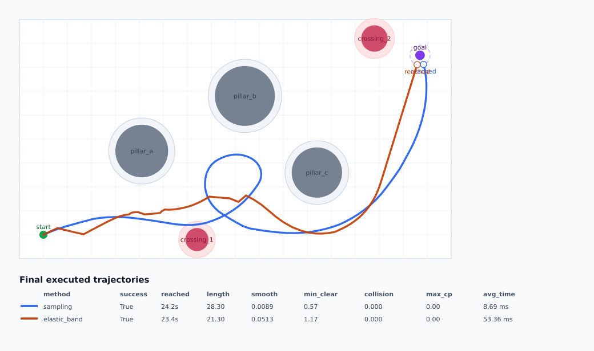
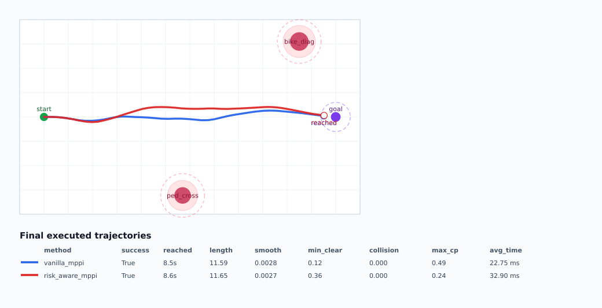
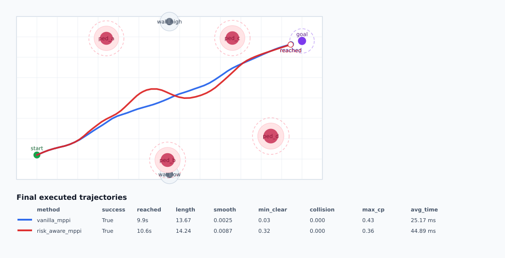

# Trajectory Planning Lab

**用 Python 实现的二维轨迹规划与动态避障实验室。**

将场景、规划器、闭环执行、指标统计和可视化串成可运行流程。支持轨迹采样、弹性带和 MPPI，核心代码与 SVG 渲染只依赖 Python 标准库。




蓝色和橙色分别为采样规划与弹性带的执行轨迹；灰色为静态障碍，粉色为动态障碍及其预测范围。上图由仓库中的演示命令直接生成。

## 可以看什么

| 实现 | 内容 |
| --- | --- |
| 轨迹采样 | 生成候选轨迹，比较目标距离、平滑性、障碍间距等代价 |
| 弹性带 | 迭代调整局部轨迹，在障碍约束下改善路径形状 |
| MPPI | 对控制序列采样、加权更新，在闭环中持续重规划 |
| 车辆约束 | 运动学自行车模型；速度、加速度、转角、转角变化率和转弯半径限制 |
| 动态避障 | 移动圆形障碍、高斯预测、预测误差与风险代价 |
| 运行记录 | 导出 CSV / JSON、轨迹对比图、过程图和 SVG 动画 |

这是可复现的二维仿真工程，目前尚未接入机器人硬件或 ROS。

## 快速运行

需要 Python 3.10 或以上，无需安装第三方 Python 包。在项目根目录运行：

```bash
# 采样规划与弹性带；生成对比图、过程图和指标
python3 -B -m planner_lab.run --out outputs/basic

# 动态交叉与走廊：基础 MPPI 对比风险代价 MPPI
python3 -B -m planner_lab.run_mppi \
  --out outputs/mppi --scenarios crossing,corridor \
  --seeds 1 --max-steps 130 --rollouts 44 --horizon 16

# 静态避障筛选与回退逻辑的现有单元测试
python3 -B -m unittest discover -s tests -v
```

用浏览器打开 `outputs/mppi/crossing/animation.svg` 可看闭环执行动画；`comparison.svg` 是轨迹对比，`process_*.svg` 展示重规划过程。运行会在 `outputs/` 中生成新结果，图片和统计可自行检查。

## 演示结果

下表来自上述动态避障演示，固定 `seed=0`，每个场景每种方法各运行一次。最小净间距是按离散执行时刻计算的圆体边界距离；`到达` 指进入目标容差范围。单次演示用于说明运行行为，不能据此判断总体性能。

| 场景 | 方法 | 到达 | 最小净间距 | 离散碰撞时刻占比 |
| --- | --- | --- | --- | --- |
| crossing | 基础 MPPI | 是 | 0.119 | 0 |
| crossing | 风险代价 MPPI | 是 | 0.359 | 0 |
| corridor | 基础 MPPI | 是 | 0.025 | 0 |
| corridor | 风险代价 MPPI | 是 | 0.317 | 0 |

这些数值使用场景坐标单位。[原始演示汇总](docs/demo/mppi_summary.csv) 与 [运行参数](docs/demo/mppi_config.json) 一同保留；计算耗时随机器和负载变化。





[查看重规划过程](docs/assets/crossing-process.svg) · [下载交叉场景动画](docs/assets/crossing-animation.svg) · [演示说明](docs/DEMO.md) · [代码结构](docs/ARCHITECTURE.md)

## 修改场景与参数

- `planner_lab/scenario.py`：定义场景、静态/动态障碍和预测模型。
- `planner_lab/mppi.py`：MPPI 控制采样、车辆模型与轨迹评估。
- `--uncertainty`：改变预测不确定性；`--lambda-cp`、`--lambda-hard`：调整风险代价。
- `--rollouts`、`--horizon`：调整采样数量与规划时域。
- `--scenarios`：选择 `crossing,corridor,intersection,blocked_line,blocked_crossing`。

完整参数：`python3 -m planner_lab.run_mppi --help`。先使用一个场景、一个随机种子调试，再增加场景与运行次数。

来源与依赖说明见 [`ATTRIBUTION.md`](ATTRIBUTION.md)。
